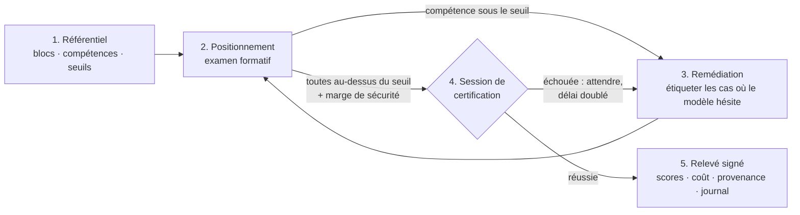

# Piolet — entraîner sur preuve

Piolet est un greffon d'entraînement. Il pilote un modèle d'IA comme on forme un professionnel. On part d'un référentiel de compétences, on fait passer un examen par compétence, on n'entraîne que ce qui manque, et on s'arrête dès que la preuve est faite. Tout est consigné dans un relevé que chacun peut vérifier.

Piolet est publié par IMDTEC SAS, organisme de formation certifié Qualiopi, sous licence Apache-2.0.

> **Statut : version 0.1, prototype de recherche.** Les chiffres ci-dessous sont mesurés sur un banc d'essai public et reproductible. Ils ne disent pas encore ce que la méthode donne sur un grand modèle de langage : c'est l'objet du programme de recherche.

## En bref

- **140 étiquettes au lieu de 897** pour certifier un modèle au niveau requis, soit 84 % de moins (médiane sur 20 graines).
- **46 époques au lieu de 200** (médiane ; 97 en moyenne, car un modèle qui plafonne près du seuil va jusqu'au budget). Sur un test jamais vu, le niveau tient aussi souvent qu'après 200 époques : 85 % des modèles dans les deux cas.
- **Aucune donnée issue d'un modèle tiers.** La garde de provenance refuse tout exemple qui n'indique pas son origine, ou qui vient d'un autre modèle.
- **Un résultat négatif publié.** Notre variante « ciblée » n'a pas fait mieux que la méthode classique d'incertitude. Nous la gardons, documentée, mais elle n'est pas la stratégie par défaut.

Le détail des chiffres est dans [banc/RESULTATS.md](banc/RESULTATS.md). Ils sont aussi présentés dans l'application [docs/index.html](docs/index.html), une page autonome qui peut être publiée avec GitHub Pages.

## Pourquoi

Entraîner un modèle coûte d'abord des **étiquettes** : du temps humain pour écrire ou corriger des exemples. Il faut ensuite du **calcul**, en heures de processeur ou de GPU. L'habitude est d'entraîner au volume : plus d'exemples, plus d'époques, puis une note moyenne. Deux résultats publiés montrent qu'on peut faire autrement :

- **LIMA** (Zhou et al., NeurIPS 2023) : 1 000 exemples soignés suffisent à aligner un modèle de 65 milliards de paramètres. Mais les auteurs notent que rédiger ces exemples demande un effort important et difficile à passer à l'échelle.
- **LoRA** (Hu et al., 2021) et **QLoRA** (Dettmers et al., NeurIPS 2023) : on gèle le modèle et on n'entraîne que de petites matrices. QLoRA affine un modèle de 65 milliards de paramètres sur un seul GPU de 48 Go.

Ces méthodes ne répondent pas à deux questions : **quels exemples écrire**, et **quand s'arrêter**. Un organisme de formation y répond chaque jour. Il positionne le stagiaire avant la formation, ne lui fait travailler que ce qu'il ne maîtrise pas, et le certifie par un examen distinct de ses exercices. Piolet applique cette discipline à un modèle.

## La méthode, en cinq étapes



1. **Référentiel.** Il fixe des blocs et des compétences, avec un seuil pour chacune, comme un titre RNCP. Le modèle est certifié seulement si **chaque** compétence atteint son seuil : une bonne moyenne ne suffit pas.
2. **Positionnement.** Le modèle passe l'examen formatif avant d'être entraîné. S'il réussit déjà, on n'entraîne pas.
3. **Remédiation.** On ne fait étiqueter que les cas où le modèle hésite le plus, c'est-à-dire ceux dont les deux classes les plus probables sont proches. C'est l'apprentissage actif décrit par Settles (2009).
4. **Certification.** Quand l'examen formatif dépasse chaque seuil d'une marge de sécurité, une session s'ouvre : le modèle passe un **examen certificatif** distinct, scellé jusque-là. En cas d'échec, l'entraînement reprend, et l'attente avant la session suivante double. Le nombre de sessions est limité, et une session finale a lieu si le budget s'épuise.
   Pourquoi deux examens ? Repasser sans cesse le même examen finit par donner un résultat trop flatteur (Dwork et al., *Science*, 2015). Le banc le confirme : s'arrêter au premier examen formatif réussi coûte moins d'étiquettes, mais le niveau ne tient alors que pour 55 % des modèles sur le test final.
5. **Relevé signé.** Il consigne les scores par compétence, un ticket de coût où chaque ligne est marquée « mesuré » ou « estimé », la provenance des données, et un journal chaîné par empreintes SHA-256 dont l'ancre peut être signée par HMAC.

Deux gardes complètent la méthode :

- **Garde de provenance.** Un exemple sans provenance, ou issu d'un modèle tiers, est refusé. Les raisons sont juridiques, car les conditions d'utilisation de nombreux fournisseurs l'interdisent pour entraîner un modèle concurrent. Elles tiennent aussi à la qualité : sur des données générées par d'autres modèles, un modèle perd la diversité des données d'origine (Shumailov et al., *Nature*, 2024).
- **Garde de promotion.** Un nouveau modèle ne remplace l'ancien que s'il ne recule sur **aucune** compétence au même examen.

## Ce que Piolet ne prétend pas

L'apprentissage actif, l'arrêt précoce et LoRA existent déjà. Piolet n'invente aucune de ces briques. Ce que nous proposons, c'est leur **assemblage piloté par un référentiel de compétences**, avec quatre éléments :

- des seuils par compétence fixés par des formateurs ;
- une certification à deux examens, avec des sessions limitées ;
- une garde de provenance et une garde de promotion ;
- un relevé vérifiable.

Le tout est mesuré sur un banc public, avec ses limites.

## Résultats mesurés

Le banc utilise les 1 797 images de chiffres manuscrits fournies avec scikit-learn. Le référentiel compte dix compétences, une par chiffre, chacune avec un seuil F1 de 0,90. Pour chacune des 20 graines, les images sont réparties sans recouvrement :

- examen formatif : 300 images ;
- examen certificatif : 300 images ;
- test final jamais vu par la méthode : 300 images ;
- réservoir à étiqueter : 897 images.

**Expérience A : étiquettes.** Le modèle est une régression logistique sur un noyau RBF approché.

- Volume, tout le réservoir étiqueté : **897** étiquettes. Le niveau tient sur le test final pour 100 % des modèles.
- Piolet : **140** étiquettes (quartiles 120 à 153). Certifiés : 100 %. Le niveau tient sur le test final pour 85 % des modèles ; le F1 le plus bas vaut 0,927 en moyenne, contre 0,947 au volume, qui va au-delà du niveau requis.
- Arrêt au premier examen réussi : **100** étiquettes, mais le niveau ne tient que pour 55 % des modèles.
- Choix des cas au hasard, avec l'arrêt Piolet : **505** étiquettes.
- Piolet sans marge de sécurité : **120** étiquettes, niveau tenu pour 75 % des modèles. La marge a un prix explicite.
- Variante ciblée : **155** étiquettes, niveau tenu pour 70 % des modèles. C'est le résultat négatif signalé plus haut.

**Expérience B : époques.** Le modèle est un perceptron à une couche cachée, entraîné sur tout le réservoir.

- 200 époques fixes : certifiés 95 % ; niveau tenu pour 85 % des modèles.
- Piolet : **46** époques en médiane (quartiles 22 à 200). Certifiés 95 % ; niveau tenu pour 85 % des modèles. Quand le modèle plafonne près du seuil, Piolet va jusqu'au budget et passe la session finale : il ne coûte alors pas plus que l'entraînement fixe.
- Arrêt précoce standard de scikit-learn : **20** époques, mais 20 % seulement de modèles certifiés. Cet arrêt surveille la perte de validation, pas le niveau exigé.

**Limites.** Le jeu de données est petit et les modèles sont simples. Une certification se fait à un seuil : un modèle certifié juste au-dessus peut passer sous le seuil sur un autre échantillon. Les temps de calcul dépendent de la machine ; les comptes d'étiquettes et d'époques n'en dépendent pas.

Le protocole a été changé une fois, le jour même : la [section Historique de banc/RESULTATS.md](banc/RESULTATS.md#historique-de-la-méthode) explique pourquoi.

## Installer et essayer

```bash
git clone <adresse du dépôt> piolet && cd piolet
python -m venv .venv && source .venv/bin/activate
pip install -e ".[dev]"
pytest -q                                   # 22 tests, quelques secondes
piolet banc --graines 20 --page docs/index.html   # le banc complet, 2 à 3 minutes
piolet referentiel valider exemples/skillvora-dwwm/referentiel.yaml
piolet cout-lora --couches 32 --dim 4096 --cibles q,v --rang 8 --total 6.74e9
piolet journal verifier banc/journal-demo.jsonl --ancre banc/ancre-demo.json
```

## Utiliser Piolet dans son code

```python
from piolet import ArretSurPreuve, Referentiel, remedier

ref = Referentiel.charger("mon_referentiel.yaml")
trajectoire = remedier(
    ref, modele, X_reservoir, etiqueter,           # etiqueter(indices) -> étiquettes
    formatif=(X_formatif, y_formatif),
    certificatif=(X_certificatif, y_certificatif),
    amorce=indices_amorce, lot=10,
    arret=ArretSurPreuve.depuis(ref),
)
print(trajectoire.certifie, trajectoire.etiquettes, trajectoire.sessions)
```

Un modèle est tout objet qui sait `entrainer(X, y)`, `proba(X)` et `predire(X)`. Trois adaptateurs scikit-learn sont fournis. D'autres se branchent par le groupe de points d'entrée `piolet.modeles` : c'est le mécanisme de greffon (`piolet modeles` les liste).

## Brancher Piolet sur Hugging Face et LoRA

```python
from transformers import Trainer, TrainingArguments
from peft import get_peft_model
from piolet import ArretSurPreuve, Referentiel
from piolet.hf import PioletCallback, config_lora, dossier_adaptateur

ref = Referentiel.charger("referentiel.yaml")
modele = get_peft_model(modele_de_base, config_lora(rang=8, cibles=("q_proj", "v_proj")))
rappel = PioletCallback(ArretSurPreuve.depuis(ref), examiner_formatif, examiner_certificatif)
Trainer(model=modele, args=TrainingArguments(output_dir="sortie", num_train_epochs=20, save_strategy="no", report_to="none"),
        train_dataset=donnees, callbacks=[rappel]).train()   # s'arrête dès la certification
modele.save_pretrained(dossier_adaptateur(".", "BC01"))      # un adaptateur par bloc
```

Le script complet se trouve dans [exemples/lora_hf.py](exemples/lora_hf.py). Il demande `pip install "piolet[hf]"`, un modèle et, de préférence, un GPU. **Il n'est pas exécuté dans l'intégration continue.** La logique du greffon, elle, est testée sans GPU (`tests/test_boucles.py`). Le calculateur `piolet cout-lora` compte les paramètres ajoutés : sur un modèle de 7 milliards de paramètres (32 couches, dimension 4 096), un adaptateur de rang 8 sur les matrices q et v ajoute 4 194 304 paramètres, soit 0,06 % du modèle.

## Atelier : la boucle avec de vrais formateurs

```bash
piolet tour --referentiel exemples/skillvora-dwwm/referentiel.yaml \
            --etiquetes etiquetes.csv --reservoir reservoir.csv --journal journal.jsonl
```

À chaque tour, Piolet procède en quatre temps :

1. il vérifie la provenance des exemples et des examens ;
2. il entraîne le modèle et lui fait passer l'examen formatif ;
3. il ouvre une session de certification si le niveau le permet ;
4. si le modèle n'est pas certifié, il écrit `a_etiqueter.csv` : les cas à soumettre aux formateurs avant le tour suivant.

L'état est relu dans le journal : le journal **est** l'état.

## Premier usage : Skillvora

[Skillvora](https://skillvora.imdtec.net) évalue des candidats sur des épreuves tirées du poste. Son modèle Piolet SkillMatch relie une tâche de poste à une compétence d'un titre professionnel. Le dossier [exemples/skillvora-dwwm](exemples/skillvora-dwwm) contient son référentiel pour le titre Développeur web et web mobile (RNCP37674) : deux blocs et huit compétences, aux intitulés recopiés de la fiche France compétences.

Les examens sont **vides à dessein**. Ce sont les formateurs qui les rédigent : 30 tâches par compétence pour chaque examen, soit 480 tâches au total. Aucun modèle tiers ne les écrit. Rien n'est entraîné sur ce référentiel avant que ce travail soit fait.

## Application : Piolet Relevé

[docs/index.html](docs/index.html) est une page autonome, en trois parties :

- le relevé de compétences du modèle de démonstration ;
- le banc d'essai, avec ses graphiques ;
- un calculateur LoRA.

Elle ne contacte aucun serveur, et un relevé produit par Piolet peut y être ouvert sans être envoyé. Pour la mettre en ligne : *Settings → Pages → Branch : main, dossier /docs*.

## Organisation du dépôt

```
piolet/            le greffon (référentiel, examen, arrêt, remédiation, gardes, journal, relevé, CLI)
piolet/hf.py       arrêt sur preuve dans Hugging Face Trainer, un adaptateur LoRA par bloc
piolet/atelier.py  la boucle avec des formateurs, un tour à la fois
banc/              résultats du banc public (JSON, compte rendu, journal et relevé de démonstration)
docs/index.html    l'application Piolet Relevé
exemples/          référentiel Skillvora DWWM (RNCP37674) et script LoRA
tests/             22 tests
```

## Références

- Settles, B. (2009). *Active Learning Literature Survey*. Computer Sciences Technical Report 1648, University of Wisconsin–Madison.
- Hu, E. J. et al. (2021). *LoRA: Low-Rank Adaptation of Large Language Models*. arXiv:2106.09685.
- Dettmers, T., Pagnoni, A., Holtzman, A., Zettlemoyer, L. (2023). *QLoRA: Efficient Finetuning of Quantized LLMs*. NeurIPS 2023. arXiv:2305.14314.
- Zhou, C. et al. (2023). *LIMA: Less Is More for Alignment*. NeurIPS 2023. arXiv:2305.11206.
- Dwork, C., Feldman, V., Hardt, M., Pitassi, T., Reingold, O., Roth, A. (2015). *The reusable holdout: Preserving validity in adaptive data analysis*. Science.
- Shumailov, I. et al. (2024). *AI models collapse when trained on recursively generated data*. Nature 631, 755–759.
- AFNOR (2024). *AFNOR Spec 2314 : Référentiel général pour l'IA frugale*.
- France compétences. Fiche RNCP37674 : titre professionnel Développeur web et web mobile.
- Haber, S., Stornetta, W. S. (1991). *How to time-stamp a digital document*. Journal of Cryptology 3(2), 99–111. RFC 2104 (HMAC). NIST FIPS 180-4 (SHA-256).

## English summary

Piolet is a training plug-in that drives a model the way vocational training drives a learner. It works from a competency framework with a threshold per competency. The model takes a formative exam first and is trained only where it falls short, using uncertainty sampling. A separate, sealed certification exam decides when to stop, with a limited number of sessions and a delay that doubles after each failure. Every run produces a verifiable record: per-competency scores, a cost ticket marking each figure as measured or estimated, data provenance, and a hash-chained log. A provenance gate rejects third-party model outputs; a promotion gate blocks any per-competency regression.

The public benchmark uses scikit-learn digits over 20 seeds. Piolet certifies with 140 labels instead of 897 (−84%, median), and with 46 epochs instead of 200 (median), at the same final-test validity as 200 fixed epochs (85%). Stopping at the first passed exam is cheaper (100 labels) but holds on the final test for only 55% of models. Our "targeted" sampling variant did not beat plain uncertainty, and we report it as a negative result. Transfer to LoRA fine-tuning of large language models is the next research step. Licence: Apache-2.0.

## Licence et citation

Apache-2.0 (voir [LICENSE](LICENSE) et [NOTICE](NOTICE)). Pour citer Piolet : [CITATION.cff](CITATION.cff).
